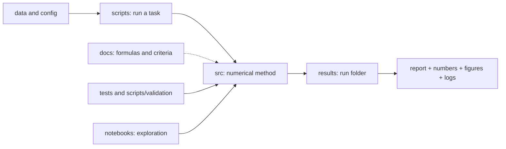

# Elastic DAS project map

Where modules, entry points, input data and results are. Layout rule: in
the [README](../README.md), current status: in
[status.md](status.md), results layout: in
[results/README.md](../results/README.md).

## Library `src/`

Import by full path only: `from src.<package>.<module> import ...`.
A short description of the packages is in the `src/__init__.py` docstring.

| Task | Location |
| --- | --- |
| Grid, elastic model, filters | `src/common/`: `grid.py` (`Grid2D`), `model.py` (`ElasticModel2D`), `signal_processing.py` (band-pass filter and PSD for SAFOD comparisons) |
| Legacy solver on a staggered grid | `src/elastic/`: `solver_numpy.py` (NumPy), `solver_numba_fused.py` (Numba); both backends must stay mathematically consistent |
| Forward-run assembly | `src/elastic/simulator.py`: `run_forward_simulation` connects the solver, source, receivers and DAS |
| Source | `src/elastic/source.py` (2-D moment tensor, source time function), `src/elastic/source_spreading.py` (bilinear spreading of the source over staggered-grid nodes), `src/elastic/source_injection.py` (source → arrays for the solver) |
| Sampling the field at receivers | `src/elastic/sampling.py`: bilinear sampling and adjoint spreading |
| Point-force solver | `src/elastic/solver_numpy_pointforce.py`: only for the checks `scripts/validation/elastic/pointforce_2d.py` and `reciprocity.py` |
| DAS cable geometry | `src/das/receivers.py`: `Receivers2D`, building the cable from points, tangents |
| DAS observation operator | `src/das/strain.py`: axial strain and strain rate over a finite gauge length, adjoint operator |
| Analytical references | `src/analytical/`: `pointforce_2d.py` (2-D point force), `moment_tensor.py` (moment tensor) |
| Legacy-solver FWI | `src/fwi/`: `two_layer.py` (two-layer setup and Numba forward), `adjoint_numba.py` (exact discrete adjoint of the Numba solver), `gradient_numba.py` (gradient with checkpointing), `misfit.py` (DAS L2 misfit; not yet used in `gradient_numba.py`) |
| SBP-SAT | `src/sbp_sat/`: `operators.py` (1-D SBP operators on a staggered grid, 4th order in the interior, 2nd at the boundary), `elastic2d.py` (2-D forward, adjoint, gradient with respect to log Vp / log Vs); formulas: [method.md](sbp_sat/method.md) |
| SAFOD velocity models | `src/safod/models/`: `factory.py` (`build_initial_model` by name; list of names: `AVAILABLE_INITIAL_MODELS`) and one module per model |
| SAFOD model figures | `src/safod/plotting.py` |
| SAFOD predicted P/S | `src/safod/travel_times.py`: Zhang 2009 3-D, then original Lin 2010 on coverage errors (`src/safod/lin2010.py`), through EikoHypoTomo; one shared 3-D reference for real and synthetic comparison panels; [runbook](safod/travel_times.md) |
| SAFOD-deep archive | `src/safod_deep/catalog.py`: inventory of HDF5 recordings, NCEDC catalog, 3-D cable geometry |

`safod_deep` is the continuous-recording archive of the SAFOD-deep fiber (HDF5
on Oak), not "deep events".

## Entry points `scripts/`

Always run from the project root; the full table of checks with criteria:
[scripts/validation/README.md](../scripts/validation/README.md).

| Task | Location |
| --- | --- |
| SBP-SAT checks | `scripts/validation/sbp_sat/`: `operator_qc`, `adjoint_dot_product`, `taylor`, `normal_incidence_qc`, `oblique_qc`, `time_energy_qc`; commands only in [validation.md](sbp_sat/validation.md) |
| Legacy-solver checks | `scripts/validation/elastic/`: `pointforce_2d`, `reciprocity`, `source_radiation`, `moment_tensor_analytical`, `moment_tensor_linearity`, `magnitude_scaling`, `boundary_absorption`, `free_surface_normal_incidence_qc`, `free_surface_graves_fs1_qc` |
| FWI checks | `scripts/validation/fwi/`: `two_layer_numba`, `two_layer_adjoint_dot_product`, `two_layer_taylor` |
| Demo run | `scripts/examples/homogeneous_demo.py` |
| NumPy and Numba speed | `scripts/benchmarks/`: `backends.py` (backend comparison), `performance.py` (scaling, JSON and figures) |
| SAFOD event: pipeline | `scripts/safod/`: `settings.py` (`EVENTS` registry, external paths, `results/events/` layout), `prepare_event.py`, `calibrate_channel_registration.py`, `run_forward.py`, `compare_event.py`, `plot_das_geophone_two_physical_comparisons.py` (DAS and geophone MH029); order: [workflow.md](safod/workflow.md) |
| SAFOD event search and selection | `scripts/safod/selection/`: `find_catalog_events.py`, `check_catalog_coverage.py`, `screen_events.py` |
| Preparing velocity-model inputs | `scripts/safod/velocity_models/`: `digitize_ellsworth_malin_fig3a.py`, `zhang2009/`; write to `data/safod/velocity_models/`. The models themselves are built by `src/safod/models/` |
| SAFOD diagnostics and one-off experiments | `scripts/safod/experiments/`: `diagnose_geometry.py`, `oct03_2026/` (2026-10-03 event, [README](../scripts/safod/experiments/oct03_2026/README.md)); not part of the pipeline |
| SAFOD-deep archive | `scripts/safod_deep/`: `scan_nano_manifest.py`, `build_event_catalog.py`, `plot_catalog_events.py`, `plot_catalog_events_array.sbatch` |
| Old code | `scripts/legacy/` ([README](../scripts/legacy/README.md)) |

## Tests, notebooks, inputs, web

| Task | Location |
| --- | --- |
| Automated tests | `tests/` (`test_project_layout.py`: old names, `python -m` targets, markdown links; `test_safod_smooth_prior_explicit_bounds.py`), `web_safod/tests/`; configuration: `pytest.ini`; running: [setup.md](setup.md) |
| Solver demo | `notebooks/final_demo.ipynb`, environment `fwi`: homogeneous run, `pointforce_2d` check, benchmarks; via scripts writes to `results/validation/elastic/pointforce_2d/` and `results/benchmarks/performance/` |
| DAS and geophone MH030 for NC75379261 | `notebooks/NC75379261_DAS_geophone.ipynb`, environment `geo`: HDF5 on Oak and NCEDC; writes `results/events/20260618_75379261/compare/das_geophone_common_workflow/` |
| SAFOD-deep archive roots | `config/safod_deep/roots.json` (paths on Oak; read by `scripts/safod_deep/build_event_catalog.py`) |
| Velocity-model inputs | `data/safod/velocity_models/<source>/` (usually `raw/`, `processed/`; local, outside Git). Model-preparation QC sits next to them in `qc/`, an agreed exception to the `results/` rule |
| Raw DAS records, environments, external paths | on Oak and in `/home/groups`; list: [setup.md](setup.md) |
| Web viewer | `web_safod/`: `builder/` (build library), `scripts/` (entry points), `templates/` (page sources), `config/`, `reference/`, `docs/`, `tests/`, `site/` (generated; only README in Git), `cache/` (build cache and logs); [README](../web_safod/README.md) |
| History, earlier handoffs, moves | `docs/history/README.md` (only in the local copy, outside Git) |

## Workflow diagram

