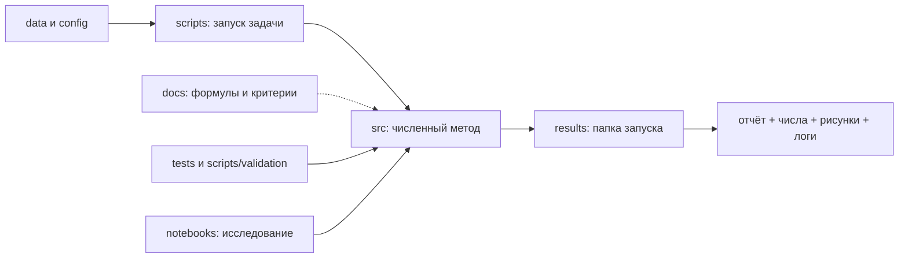

# Карта проекта Elastic DAS

Где лежат модули, точки входа, входные данные и результаты. Правило
размещения — в [README](../README.md), текущее состояние — в
[status.md](status.md), раскладка результатов — в
[results/README.md](../results/README.md).

## Библиотека `src/`

Только импорт по полному пути: `from src.<пакет>.<модуль> import ...`.
Краткое описание пакетов — docstring `src/__init__.py`.

| Задача | Место |
| --- | --- |
| Сетка, упругая модель, фильтры | `src/common/`: `grid.py` (`Grid2D`), `model.py` (`ElasticModel2D`), `signal_processing.py` (полосовой фильтр и PSD для сравнений SAFOD) |
| Прежний решатель на сдвинутой сетке | `src/elastic/`: `solver_numpy.py` (NumPy), `solver_numba_fused.py` (Numba); оба бэкенда должны оставаться математически согласованными |
| Сборка forward-расчёта | `src/elastic/simulator.py`: `run_forward_simulation` связывает решатель, источник, приёмники и DAS |
| Источник | `src/elastic/source.py` (2-D тензор момента, функция источника), `src/elastic/source_spreading.py` (билинейное распределение источника по узлам сдвинутой сетки), `src/elastic/source_injection.py` (источник → массивы для решателя) |
| Выборка поля в приёмниках | `src/elastic/sampling.py`: билинейная выборка и сопряжённое рассеяние |
| Решатель для точечной силы | `src/elastic/solver_numpy_pointforce.py` — только для проверок `scripts/validation/elastic/pointforce_2d.py` и `reciprocity.py` |
| Геометрия кабеля DAS | `src/das/receivers.py`: `Receivers2D`, построение кабеля по точкам, касательные |
| Оператор наблюдения DAS | `src/das/strain.py`: осевая деформация и скорость деформации на конечной gauge length, сопряжённый оператор |
| Аналитические эталоны | `src/analytical/`: `pointforce_2d.py` (точечная сила 2-D), `moment_tensor.py` (тензор момента) |
| FWI прежнего решателя | `src/fwi/`: `two_layer.py` (двухслойная постановка и forward на Numba), `adjoint_numba.py` (точный дискретный adjoint решателя Numba), `gradient_numba.py` (градиент с контрольными точками), `misfit.py` (L2 misfit DAS; пока не используется в `gradient_numba.py`) |
| SBP-SAT | `src/sbp_sat/`: `operators.py` (1-D SBP-операторы на сдвинутой сетке, 4-й порядок внутри, 2-й на границе), `elastic2d.py` (2-D forward, adjoint, градиент по log Vp / log Vs); формулы — [method.md](sbp_sat/method.md) |
| Скоростные модели SAFOD | `src/safod/models/`: `factory.py` (`build_initial_model` по имени; список имён — `AVAILABLE_INITIAL_MODELS`) и по модулю на модель |
| Рисунки моделей SAFOD | `src/safod/plotting.py` |
| Архив SAFOD-deep | `src/safod_deep/catalog.py`: инвентаризация HDF5-записей, каталог NCEDC, 3-D геометрия кабеля |

`safod_deep` — непрерывный архив записей волокна SAFOD-deep (HDF5 на Oak),
а не «глубокие события».

## Точки входа `scripts/`

Запуск всегда из корня проекта; полная таблица проверок с критериями —
[scripts/validation/README.md](../scripts/validation/README.md).

| Задача | Место |
| --- | --- |
| Проверки SBP-SAT | `scripts/validation/sbp_sat/`: `operator_qc`, `adjoint_dot_product`, `taylor`, `normal_incidence_qc`, `oblique_qc`, `time_energy_qc`; команды — только в [validation.md](sbp_sat/validation.md) |
| Проверки прежнего решателя | `scripts/validation/elastic/`: `pointforce_2d`, `reciprocity`, `source_radiation`, `moment_tensor_analytical`, `moment_tensor_linearity`, `magnitude_scaling`, `boundary_absorption`, `free_surface_normal_incidence_qc`, `free_surface_graves_fs1_qc` |
| Проверки FWI | `scripts/validation/fwi/`: `two_layer_numba`, `two_layer_adjoint_dot_product`, `two_layer_taylor` |
| Демонстрационный расчёт | `scripts/examples/homogeneous_demo.py` |
| Скорость NumPy и Numba | `scripts/benchmarks/`: `backends.py` (сравнение бэкендов), `performance.py` (масштабирование, JSON и рисунки) |
| Событие SAFOD: конвейер | `scripts/safod/`: `settings.py` (реестр `EVENTS`, внешние пути, раскладка `results/events/`), `prepare_event.py`, `calibrate_channel_registration.py`, `run_forward.py`, `compare_event.py`, `plot_das_geophone_two_physical_comparisons.py` (DAS и геофон MH029); порядок — [workflow.md](safod/workflow.md) |
| Поиск и отбор событий SAFOD | `scripts/safod/selection/`: `find_catalog_events.py`, `check_catalog_coverage.py`, `screen_events.py` |
| Подготовка входов скоростных моделей | `scripts/safod/velocity_models/`: `digitize_ellsworth_malin_fig3a.py`, `zhang2009/`; пишут в `data/safod/velocity_models/`. Сами модели строит `src/safod/models/` |
| Диагностика и разовые эксперименты SAFOD | `scripts/safod/experiments/`: `diagnose_geometry.py`, `oct03_2026/` (событие 2026-10-03, [README](../scripts/safod/experiments/oct03_2026/README.md)); не входят в конвейер |
| Архив SAFOD-deep | `scripts/safod_deep/`: `scan_nano_manifest.py`, `build_event_catalog.py`, `plot_catalog_events.py`, `plot_catalog_events_array.sbatch` |
| Старый код | `scripts/legacy/` ([README](../scripts/legacy/README.md)) |

## Тесты, ноутбуки, входы, веб

| Задача | Место |
| --- | --- |
| Автоматические тесты | `tests/` (`test_project_layout.py` — старые имена, цели `python -m`, ссылки в markdown; `test_safod_smooth_prior_explicit_bounds.py`), `web_safod/tests/`; настройка — `pytest.ini`; запуск — [setup.md](setup.md) |
| Демонстрация решателя | `notebooks/final_demo.ipynb`, окружение `fwi`: однородный расчёт, проверка `pointforce_2d`, бенчмарки; через скрипты пишет в `results/validation/elastic/pointforce_2d/` и `results/benchmarks/performance/` |
| DAS и геофон MH030 для NC75379261 | `notebooks/NC75379261_DAS_geophone.ipynb`, окружение `geo`: HDF5 на Oak и NCEDC; пишет `results/events/20260618_75379261/compare/das_geophone_common_workflow/` |
| Корни архива SAFOD-deep | `config/safod_deep/roots.json` (пути на Oak; читает `scripts/safod_deep/build_event_catalog.py`) |
| Входы скоростных моделей | `data/safod/velocity_models/<источник>/` (обычно `raw/`, `processed/`; локально, вне Git). QC подготовки моделей лежит рядом в `qc/` — оговорённое исключение из правила `results/` |
| Сырые записи DAS, окружения, внешние пути | на Oak и в `/home/groups`; перечень — [setup.md](setup.md) |
| Веб-просмотрщик | `web_safod/`: `builder/` (библиотека сборки), `scripts/` (точки входа), `templates/` (исходники страницы), `config/`, `reference/`, `docs/`, `tests/`, `site/` (генерируется; в Git только README), `cache/` (кэш и логи сборки); [README](../web_safod/README.md) |
| История, прежние handoff, переносы | `docs/history/README.md` (только в локальной копии, вне Git) |

## Схема работы

